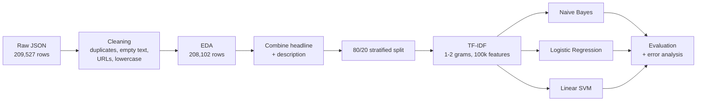

# News_Category_Detection_MS24169
# News Category Classification

Classifying news articles into **42 categories** from their headline and short description, using TF-IDF features and three classical machine-learning models (Multinomial Naive Bayes, Logistic Regression, Linear SVM).

Data Science course project · Notebook: `News_Category_Project.ipynb`

---

## Table of Contents

1. [Overview](#overview)
2. [Dataset](#dataset)
3. [Pipeline](#pipeline)
4. [Data Cleaning](#data-cleaning)
5. [Exploratory Data Analysis](#exploratory-data-analysis)
6. [Feature Extraction](#feature-extraction-tf-idf)
7. [Models](#models)
8. [Results](#results)
9. [Error Analysis](#error-analysis)
10. [Key Takeaways and Limitations](#key-takeaways-and-limitations)
11. [How to Run](#how-to-run)
12. [Output Files](#output-files)

---

## Overview

The goal is to predict an article's category (e.g. `POLITICS`, `TRAVEL`, `WELLNESS`) from its text. The project covers:

- cleaning a raw news dataset (duplicates, empty text, URLs, conflicting labels),
- exploratory analysis of class balance and text length,
- TF-IDF feature extraction with unigrams and bigrams,
- training and comparing three classifiers against a majority-class baseline,
- error analysis with confusion matrices and top terms per category,
- an extension comparing **headline only** vs **headline + description** as input.

## Dataset

- File: `News_Category_Dataset_v3.json` (JSON Lines, read with `pd.read_json(..., lines=True)`)
- Raw size: **209,527 rows × 6 columns**: `link`, `headline`, `category`, `short_description`, `authors`, `date`
- Target: `category` (42 classes in the raw data)

> The dataset file is not included in this repository because of its size. Place it in the project root before running the notebook.

## Pipeline



## Data Cleaning

| Step | What was done | Effect |
|---|---|---|
| Exact duplicates | `drop_duplicates()` | 13 duplicate rows removed (209,527 → 209,514) |
| Empty headlines | Dropped rows with blank headlines | 6 rows with 0 words removed (→ 209,508) |
| Repeated headline + category pairs | `drop_duplicates(subset=["headline","category"])` | Final dataset: **208,102 rows** |
| Conflicting labels | Same headline appearing under different categories was **kept**, since these are genuinely different articles | 102 such headlines remain |
| Case normalisation | Lowercased headline and description; category uppercased | |
| URL removal | Regex `https?://\S+\|(?<!\w)www\.\S+` | 2 headlines and 152 descriptions contained URL-like text |
| Whitespace | Collapsed repeated spaces and trimmed | |
| Missing values | Checked every column | None after cleaning |

Outlier check on headline length used the IQR rule. Single-word headlines were inspected and judged not useful, while unusually long headlines were judged valuable and kept.

## Exploratory Data Analysis

### Class distribution

Before cleaning, `POLITICS` is the largest class and `EDUCATION` the smallest.


After cleaning, the shape is the same. `POLITICS` has 35,478 articles (17.05% of the data) and `EDUCATION` has 1,014, so the dataset is clearly **imbalanced** (largest/smallest ratio is about 35:1).


### Headline length

Headlines average about 9.6 words (median 10) and range from 1 to 44 words.


### Headline vs description length

| Metric | Mean | Median | Max |
|---|---|---|---|
| Headline words | 9.61 | 10 | 44 |
| Description words | 19.61 | 19 | 241 |

About **19,603 rows (9.42%)** have an empty description. The model input falls back to the headline for those rows.


### Text length by category

Description length differs a lot between categories. `ENTERTAINMENT` and `COMEDY` have short descriptions (median 10 words), while `WELLNESS` and `PARENTING` have long ones (median 26 and 25).


## Feature Extraction (TF-IDF)

Headline and description are joined into one `combined_text` field, split **80/20** with `random_state=42` and stratified by category.

| Setting | Value |
|---|---|
| Train / test rows | 166,481 / 41,621 |
| `ngram_range` | (1, 2) |
| `stop_words` | english |
| `min_df` / `max_df` | 2 / 0.98 |
| `max_features` | 100,000 |
| `sublinear_tf` | True |
| Train matrix shape | (166,481 × 100,000) |

Highest-weighted terms per category (full table in `top_tfidf_terms_by_category.csv`) are sensible, for example `art, artist, artists` for `ARTS`, `college, students` for `COLLEGE`, and `black, police, white` for `BLACK VOICES`.

## Models

| Model | Key hyperparameters |
|---|---|
| Multinomial Naive Bayes | `alpha=0.5` |
| Logistic Regression | `C=4.0`, `solver="lbfgs"`, `max_iter=200` |
| Linear SVM (`LinearSVC`) | `C=1.0`, `max_iter=5000` |

All three were trained on the same TF-IDF features and evaluated on the same held-out test set.

## Results

### Overall comparison

| Model | Accuracy | Macro Precision | Macro Recall | Macro F1 | Weighted F1 |
|---|---|---|---|---|---|
| **Logistic Regression** | **0.6219** | 0.5571 | 0.4571 | **0.4891** | **0.6046** |
| Linear SVM | 0.6156 | 0.5277 | 0.4601 | 0.4832 | 0.5998 |
| Multinomial Naive Bayes | 0.4853 | 0.6040 | 0.1999 | 0.2119 | 0.3947 |
| *Majority baseline (POLITICS)* | 0.1705 | 0.0041 | 0.0238 | 0.0069 | 0.0497 |


**Logistic Regression is the best model** on macro F1 and accuracy, with Linear SVM a close second and about 3x faster to train (about 135 s vs about 390 s). Both are far above the 17% majority baseline. Naive Bayes has the highest macro *precision* but a very low macro *recall*: it predicts the large classes (`POLITICS`, `WELLNESS`, `ENTERTAINMENT`) far too often and almost never predicts small ones.

### Headline only vs headline + description

| Model | Input | Accuracy | Macro F1 | Weighted F1 |
|---|---|---|---|---|
| Logistic Regression | Headline + description | 0.6219 | 0.4891 | 0.6046 |
| Logistic Regression | Headline only | 0.5919 | 0.4650 | 0.5748 |
| Linear SVM | Headline + description | 0.6156 | 0.4832 | 0.5998 |
| Linear SVM | Headline only | 0.5875 | 0.4570 | 0.5723 |
| Naive Bayes | Headline + description | 0.4853 | 0.2119 | 0.3947 |
| Naive Bayes | Headline only | 0.4645 | 0.2096 | 0.3807 |

Adding the description improves accuracy by roughly **2 to 3 percentage points** for every model.

### Confusion matrices

Rows are the actual category and columns the predicted category. A strong diagonal means correct predictions.

**1. Multinomial Naive Bayes:** 21,424 of 41,621 test rows misclassified. Almost everything gets pushed into `POLITICS`, `WELLNESS` and `ENTERTAINMENT`.


**2. Logistic Regression:** 15,737 misclassified.


**3. Linear SVM:** 15,998 misclassified.


**4. Best model (Logistic Regression), final evaluation:** the same matrix regenerated in the final evaluation section, with the full table saved to `best_model_confusion_matrix.csv`.


### Figure index

| # | Figure | Section |
|---|---|---|
| 1 | Raw category distribution | EDA |
| 2 | Headline length histogram | EDA |
| 3 | Category distribution after cleaning | EDA |
| 4 | Headline and description word counts | EDA |
| 5 | Median length by category | EDA |
| 6 | Naive Bayes confusion matrix | Results |
| 7 | Linear SVM confusion matrix | Results |
| 8 | Logistic Regression confusion matrix | Results |
| 9 | Best-model confusion matrix | Results |
| 10 | Model comparison bar chart | Results |

## Error Analysis

Reading the Logistic Regression confusion matrix, most mistakes come from **categories that overlap in meaning**, not from random noise:

- `HEALTHY LIVING` is often predicted as `WELLNESS` (610 cases), and `WELLNESS` as `HEALTHY LIVING` (243).
- `PARENTS` is confused with `PARENTING` (339 and 118 cases).
- `TASTE` is predicted as `FOOD & DRINK` (227 cases), and `STYLE` as `STYLE & BEAUTY` (151).
- `ARTS`, `ARTS & CULTURE` and `CULTURE & ARTS` are mixed with each other, as are `THE WORLDPOST`, `WORLDPOST` and `WORLD NEWS`.
- Large classes (`POLITICS`, `ENTERTAINMENT`, `WELLNESS`) absorb many errors from small classes.

Strongest classes (F1 around 0.75 to 0.80) include `STYLE & BEAUTY`, `WEDDINGS`, `POLITICS`, `DIVORCE`, `HOME & LIVING` and `TRAVEL`. Weakest ones include `U.S. NEWS`, `ARTS`, `ARTS & CULTURE`, `WOMEN` and `HEALTHY LIVING`.

Misclassified examples for each model are exported to CSV (see [Output Files](#output-files)).

## Key Takeaways and Limitations

- A simple TF-IDF + linear model reaches about **62% accuracy on 42 classes**, versus 17% for the majority baseline.
- **Accuracy alone is misleading** here because of class imbalance, so macro F1 is the more honest metric (0.49 for the best model).
- The description adds useful signal over the headline alone.
- Several categories are near-duplicates in meaning (`PARENTS` vs `PARENTING`, `WORLDPOST` vs `THE WORLDPOST`, and the arts categories). This puts a ceiling on how well any text-only model can do. Merging them would likely raise scores.
- Logistic Regression did not fully converge in 200 iterations (a `ConvergenceWarning` was raised), so a higher `max_iter` might help slightly.
- No hyperparameter search or class weighting was used. Both are natural next steps, along with transformer-based models.
- The category labels are single-label, but some articles plausibly fit more than one category.

## How to Run

```bash
git clone <your-repo-url>
cd <your-repo>
pip install pandas numpy scikit-learn matplotlib jupyter
# place News_Category_Dataset_v3.json in the project root
jupyter notebook News_Category_Project.ipynb
```

Run all cells top to bottom. The cleaning cells must run before the machine-learning cells, since the ML section reuses the cleaned `df`. Training Logistic Regression takes several minutes on the full data.

## Output Files

Running the notebook writes these files:

| File | Contents |
|---|---|
| `naive_bayes_tfidf_results.csv`, `logistic_regression_tfidf_results.csv`, `linear_svm_tfidf_results.csv` | Per-model metrics |
| `final_model_comparison.csv`, `evaluation_metrics_all_models.csv` | Model comparison tables |
| `majority_class_baseline.csv` | Baseline scores |
| `headline_vs_description_metrics.csv` | Input-text extension results |
| `top_tfidf_terms_by_category.csv` | Top 10 TF-IDF terms per category |
| `best_model_confusion_matrix.csv` | Confusion matrix of the best model |
| `*_misclassified_*.csv` | Up to 1,000 misclassified examples per model |

## Team

<!-- Add your names / roll numbers here -->
